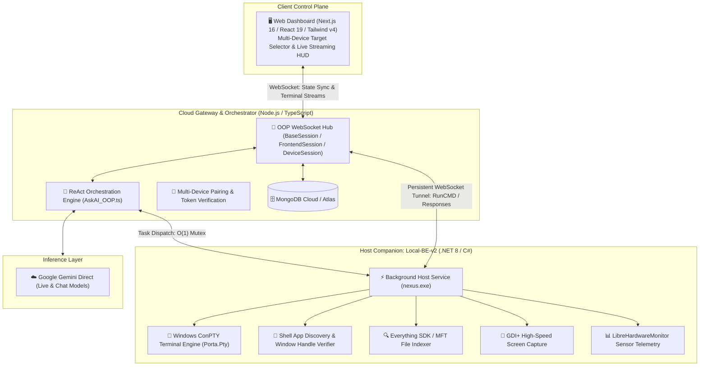

# 🌌 Nexus v2 — Distributed AI Operating System & Host Companion

[](https://github.com/Kashif-Coder404/nexus-v2)
[](https://microsoft.com/windows)
[](LICENSE)

> Nexus is an open-source, distributed desktop assistant and host companion operating system. It bridges cloud-based Large Language Models directly with native operating system capabilities—including raw Windows PowerShell, ConPTY pseudoterminals, low-latency screen inspection, file indexing, and real-time hardware telemetry—over a resilient, object-oriented WebSocket fabric.

---

## 🏗️ System Architecture

Nexus is organized into three decoupled layers: the **Client Control Plane**, the **Cloud Gateway & AI Engine**, and the **Native Host Companion**.



---

## ⚡ Core Architectural Capabilities

### 1. Object-Oriented WebSocket Engine (`backend/services/websocket`)
- **Modular Session Hierarchy**: WebSocket connections are partitioned into typed OOP sessions (`BaseWSSession`, `ClientSession`, `ClientDeviceSession`), cleanly separating browser UI clients from host machine daemons.
- **$O(1)$ Device Command Mutex**: Rather than scanning unbounded global request tables, each connected device session maintains a single active in-flight request pointer (`pendingRequest`), enforcing sequential execution safety on the host machine with constant-time resolution.
- **Graceful Disconnect Window**: If a host machine experiences a transient network drop during an in-flight operation, the gateway enters a 15-second grace buffer (`status: "reconnecting"`), preserving session continuity and allowing the host companion to reconnect and deliver results without aborting.

### 2. Multi-Device Management & Pairing Gateway
- **Zero-Trust Device Linking**: Headless companion instances generate a cryptographically random, short-lived 6-character pairing code (`NX-XXXXXX`). Linking pairs the host securely to the user's account and persists an encrypted device token.
- **Targeted Multi-PC Dispatch**: The client UI allows users to dynamically switch the active target companion from a unified selector, dispatching commands to specific physical machines ("Gaming Rig", "Work Laptop") seamlessly.

### 3. Native Windows ConPTY Terminal Execution
- **True Pseudo-Console Sessions**: Commands execute inside native Windows ConPTY sessions powered by `Porta.Pty`, capturing interactive ANSI/VT100 escape codes, color streams, and terminal prompts.
- **Dual-Layer Stream Sanitization**: Strips raw cursor-repositioning escapes and OSC window title codes in both C# and TypeScript before persisting logs to MongoDB or feeding output to model context.
- **Adaptive Execution Classification**: Fast inspection commands execute synchronously (<3.5s), while heavy workloads (compilations, large downloads) promote smoothly into streaming background tasks (`cmd_chunk`).

### 4. Self-Healing Desktop Application Launching
- **Shell-Decoupled Execution**: Launches desktop applications and games through the Windows Shell (`explorer.exe`), detaching GUI processes from terminal job objects so windows remain open independently of command sessions.
- **Two-Stage Candidate Fallback**: When an application path is not found directly, the host agent automatically queries Start Menu and Desktop shortcuts, returning deduplicated candidate paths for automated self-healing.

---

## 🧩 Component Directory

| Component | Technology Stack | Port | Primary Purpose |
| :--- | :--- | :--- | :--- |
| **`frontend/`** | Next.js 16, React 19, Tailwind v4, Zustand | `3000` | Real-time web control cockpit: multi-device selector, chat history, live streaming execution logs, and terminal drawer. |
| **`backend/`** | Node.js, Express, TypeScript, WebSocket (`ws`), Mongoose | `3100` | Gateway router, OOP WebSocket hub, JWT authentication, and autonomous `AskAI` ReAct orchestration loop. |
| **`Local-BE-v2/`** | C# (.NET 8), ConPTY (`Porta.Pty`), Win32 Shell API | `4100` | Native host companion: elevated background service managing shell processes, screen capture, and file indexing. |

---

## 🚀 Getting Started

### Prerequisites
- **Node.js** >= v20.x
- **.NET 8 SDK**
- **MongoDB** (Local instance or MongoDB Atlas connection URI)
- **Windows 10 / 11** (Administrator privileges recommended for hardware sensors and ConPTY operations)

### 1. Environment Configuration

Create a `.env` file in `backend/`:
```env
PORT=3100
MONGO_URI=mongodb://localhost:27017/nexus
JWT_SECRET=your_jwt_secret_key
GEMINI_API_KEY=your_gemini_api_key
```

Create a `.env.local` file in `frontend/`:
```env
NEXT_PUBLIC_BACKEND_URL=http://localhost:3100
NEXT_PUBLIC_WS_URL=ws://localhost:3100
```

### 2. Running the System

Open three terminal sessions:

```powershell
# Terminal 1: Cloud Backend & WebSocket Gateway
cd backend
npm install
npm run dev

# Terminal 2: Native Host Companion (Elevated Administrator)
cd Local-BE-v2/companion
dotnet watch --service

# Terminal 3: Web Dashboard
cd frontend
npm install
npm run dev
```

Open `http://localhost:3000` to access the Nexus Dashboard. Connect your host machine by entering the pairing code displayed in the companion terminal.

---

## 📁 Repository Layout

```
Nexus_v2/
├── backend/                       # Node.js TypeScript API & Gateway
│   ├── AI/                        # AskAI ReAct loop, model router, and tool definitions
│   │   ├── instructions/          # System prompts, heuristics, and operational constraints
│   │   │   └── Tools/             # Individual tool definitions (terminal, search, launch_app, etc.)
│   │   └── Types/                 # TypeScript interfaces for parser outputs and execution events
│   ├── db/                        # Mongoose schemas (users, sessions, memories)
│   ├── routes/                    # REST endpoints (auth, chat history, pairing)
│   └── services/websocket/        # OOP WebSocket architecture (BaseSession, Frontend, LocalBackend)
├── Local-BE-v2/                   # Native C# .NET 8 Host Companion
│   ├── companion/                 # Core companion agent project
│   │   ├── services/              # ExecuteServices (ConPTY), WebSocketClientService, SearchServices
│   │   └── Models/                # Data transfer objects for RPC commands
│   ├── SetupPage/                 # Embedded HTML/TSX pairing UI
│   └── nexus/                     # Packaging and distribution resources
├── frontend/                      # Next.js 16 Web Dashboard
│   ├── app/                       # App Router pages (chat, devices, workbench)
│   │   ├── components/            # UI components (SendMsg, ExecutionsStep, XTerminal)
│   │   └── store/                 # Zustand stores (useChat, useDevices, useUserCredentials)
│   └── services/                  # WebSocket listener and HTTP API services
├── TASKS.md                       # Engineering roadmap & active milestones
└── README.md                      # System documentation
```

---

## 📄 License

This project is licensed under the MIT License. See [LICENSE](LICENSE) for details.